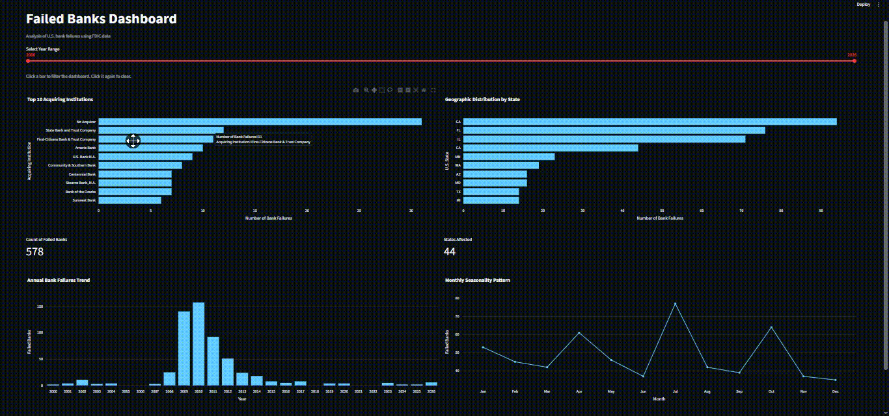
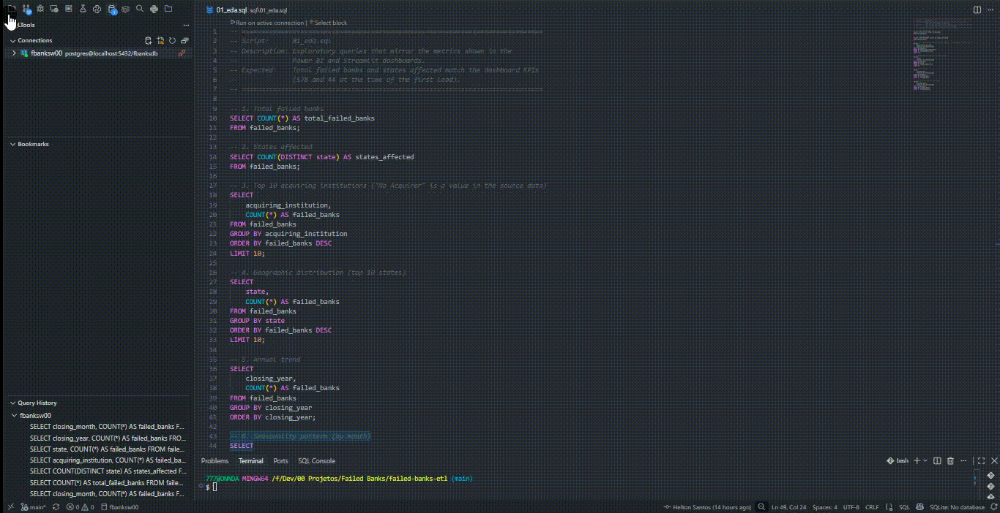
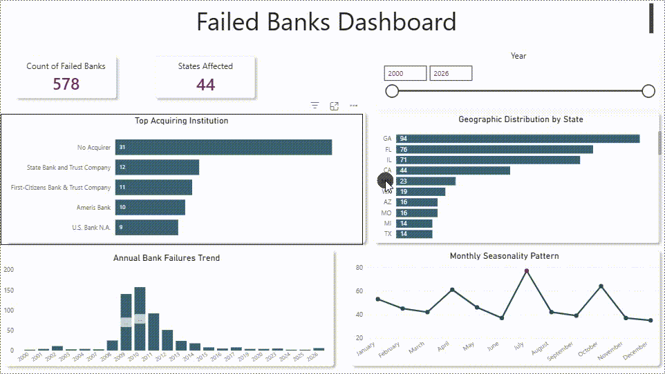

# 🏦 FDIC Failed Banks — ETL Pipeline & Interactive Dashboard

End-to-end data project that extracts U.S. bank failure records from the FDIC, transforms them with Python, loads them into PostgreSQL and delivers the insights through SQL analysis, an interactive Streamlit dashboard and a Power BI report.



---

## 📌 Overview

The Federal Deposit Insurance Corporation (FDIC) publishes the list of every U.S. bank failure since 2000. This project turns that raw CSV into a clean, queryable dataset and answers business questions such as:

- How many banks failed, and in how many states?
- When did failures peak, and is there a seasonal pattern?
- Which states concentrate the most failures?
- Which institutions acquired the most failed banks?

**Dataset at a glance (first load):** 578 failed banks · 44 states affected · 2000–2026.

---

## 🧰 Tech Stack

| Layer | Tools |
|---|---|
| Language | Python 3.12+ |
| Data processing | pandas |
| Database | PostgreSQL, SQLAlchemy, psycopg2 |
| Analysis | SQL |
| Dashboards | Streamlit, Plotly, Power BI |
| Dependency management | uv |
| Configuration | python-dotenv |

---

## 🏗️ Architecture

```text
        FDIC FAILED BANKS DATA PLATFORM

    ┌────────────────────────────┐
    │        FDIC SOURCE         │
    │     Public CSV dataset     │
    └──────────────┬─────────────┘
                   ▼
    ┌────────────────────────────┐
    │    PYTHON ETL PIPELINE     │
    ├────────────────────────────┤
    │  1. Extract   · pandas     │
    │  2. Transform · pandas     │
    │  3. Load      · SQLAlchemy │
    └──────────────┬─────────────┘
                   ▼
    ┌────────────────────────────┐
    │         POSTGRESQL         │
    │        failed_banks        │
    └──────────────┬─────────────┘
                   │
                   ├──▶ SQL analysis   (EDA · data quality · rankings)
                   ├──▶ Streamlit      (interactive dashboard)
                   └──▶ Power BI       (BI reporting)
```

| Step | Module | Responsibility |
|---|---|---|
| Extract | `src/extract.py` | Downloads the FDIC CSV into a DataFrame (ISO-8859-1 encoded source). |
| Transform | `src/transformations.py` | Standardizes column names to snake_case, parses `closing_date` and derives month, year and quarter. |
| Load | `src/load.py` | Writes the clean DataFrame to the `failed_banks` table (full reload on every run). |
| Connection | `src/db.py` | Builds the SQLAlchemy engine from environment variables, shared by the pipeline and the dashboard. |
| Orchestration | `main.py` | Runs extract, transform and load in sequence. |

---

## 📂 Project Structure

```
failed-banks-etl/
├── app/
│   └── dashboard.py            # Streamlit dashboard
├── dashboard-power-bi/
│   └── failed_banks_dashboard.pbix
├── images/                     # Screenshots and demo GIFs
├── sql/
│   ├── 01_eda.sql              # Exploratory queries (dashboard KPIs and charts)
│   ├── 02_data_quality.sql     # Row count, nulls, duplicates and date checks
│   ├── 03_business_analysis.sql
│   └── 04_rankings.sql         # Top 10 years and states
├── src/
│   ├── db.py
│   ├── extract.py
│   ├── transformations.py
│   └── load.py
├── main.py                     # ETL entry point
├── pyproject.toml
└── uv.lock
```

---

## 🚀 Getting Started

### Prerequisites

- Python 3.12 or higher
- [uv](https://docs.astral.sh/uv/)
- A running PostgreSQL instance

### 1. Clone and install dependencies

```bash
git clone https://github.com/heltonwo/fdic-failed-banks-etl.git
cd fdic-failed-banks-etl
uv sync
```

### 2. Configure the database connection

Create a `.env` file in the project root:

```env
DB_USER=your_user
DB_PASSWORD=your_password
DB_HOST=localhost
DB_PORT=5432
DB_NAME=your_database
```

The `.env` file is excluded from version control.

### 3. Run the ETL pipeline

```bash
uv run python main.py
```

The pipeline ends with `PIPELINE COMPLETED SUCCESSFULLY` and creates (or recreates) the `failed_banks` table.

### 4. Launch the dashboard

```bash
uv run python -m streamlit run app/dashboard.py
```

---

## 🗄️ SQL Analysis

The `sql/` folder contains four scripts that run directly against the `failed_banks` table:

| Script | Purpose |
|---|---|
| `01_eda.sql` | Exploratory queries that mirror the KPIs and charts of both dashboards. |
| `02_data_quality.sql` | Data quality validation: row count, completeness, duplicates (by certificate number and composite key) and date boundaries. |
| `03_business_analysis.sql` | Failures by year, state, acquiring institution and month. |
| `04_rankings.sql` | Top 10 years and states by number of failures. |



**pgAdmin screenshot**


---

## 📊 Dashboards

### Streamlit (interactive, reads from PostgreSQL)

- Year range slider that filters the entire dashboard.
- Cross-filtering: click a state to filter the acquiring institutions, and click an institution to filter the states.
- KPIs, annual trend and monthly seasonality charts update with every selection.


### Power BI

First version of the dashboard, built on the same dataset. The report file is available in `dashboard-power-bi/`.



---

## 🔎 Key Findings

- **578** banks failed between 2000 and 2026, across **44** states.
- Failures peaked in **2009–2010**, during the global financial crisis.
- **Georgia (94), Florida (76), Illinois (71) and California (44)** lead the ranking of affected states.
- **July** is the peak month (77 failures), followed by October (64) and April (61).
- **"No Acquirer"** is the most frequent outcome (31 banks), a value that comes directly from the source data.

---

## ✅ Data Quality

Validation lives in `sql/02_data_quality.sql` and covers:

- Total row count against the extract step output.
- Null checks across every column.
- Duplicate detection by FDIC certificate number and by composite business key.
- Date range and invalid date checks (unparseable dates become `NaT` in the transform step).

---

## 🗺️ Roadmap

- Replace `print` statements with structured `logging`.
- Add automated tests with pytest.
- Add retry and timeout handling to the extract step.
- Publish the dashboard online.

---

## 👤 Author

**Helton Santos**

- GitHub: [@heltonwo](https://github.com/heltonwo)
- LinkedIn: [Helton Santos](https://www.linkedin.com/in/helton-santos-754a69206)

---

## 📄 Data Source

Bank failure data is publicly available from the [FDIC](https://www.fdic.gov/bank-failures).